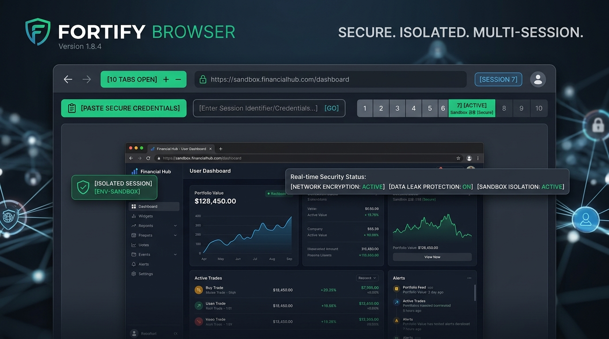

# 🌐 Multi-Session Isolated Web Browser & Credential Manager

[](https://nodejs.org/)
[](https://react.dev/)
[](https://www.typescriptlang.org/)
[](https://tailwindcss.com/)
[](https://expressjs.com/)
[](LICENSE)

A high-performance, full-stack **Multi-Session Isolated Browser & Automation Environment** engineered to run, inspect, and automate multiple distinct accounts concurrently inside an isolated sandbox. Each tab maintains an independent in-memory Cookie Jar and Session Storage, completely bypassing frame-busting protections, CSP limits, and cross-session cookie collisions.

---

## 📸 Web Demo Preview



---

## ⚡ Core Features

- **🛡️ True Multi-Session Isolation**:
  - Independent session containers (`sess-1`, `sess-2`, ..., `sess-N`).
  - Isolated server-side in-memory Cookie Jars per session; logins in Tab 1 never overwrite or conflict with Tab 2.
- **⚡ Bulk Credential Paste & Distribution**:
  - One-click clipboard paste (`[ Paste ]`) reads credentials and automatically maps them across active tabs.
  - Supports comma-separated (`user,pass`) or colon-separated (`user:pass`) lines.
  - Multi-line input maps Line 1 to Tab 1, Line 2 to Tab 2, etc., creating new tabs on the fly if needed.
- **🔕 Anti-Flicker & Zero Keyboard Hang Engine**:
  - Uses native DOM property setters and standard event dispatching without triggering artificial input focus.
  - Prevents mobile/virtual soft keyboards from frantically opening, closing, or freezing the device UI.
- **🔓 Frame-Busting & CSP Stripping Proxy Engine**:
  - Strips `X-Frame-Options`, `Content-Security-Policy`, and anti-iframe busting script headers (`frame-ancestors`).
  - Automatically rewrites relative and absolute asset paths (`.js`, `.css`, media, fonts, and API requests).
  - Handles forms (multipart, raw binary, JSON, and URL-encoded) and supports transparent 302/301 redirects.
- **🎯 Dynamic CodeIgniter / PHP Framework BaseHref Resolver**:
  - Intelligent base href calculation ensures deep application routing paths (e.g. `index.php/login2`) never lose asset bindings.
- **🔄 Dedicated Tab Navigation & Live Indicators**:
  - Single-line numbered tab switchers (`1 2 3 4 5 6 ...`) directly beneath the paste action bar.
  - Live visual indicators (emerald dot for filled credentials, pulsing blue dot for active network loading).

---

## 🏗️ Architecture Overview

```
 ┌─────────────────────────────────────────────────────────────┐
 │                React Client Frontend (Vite)                 │
 │                                                             │
 │   [Back] [Tab Qty] [Link Bar]  [Open in All]                │
 │   [📋 Paste] [Credentials Input (user,pass)] [Reload]       │
 │   [1] [2] [3] [4] [5] [6] [7] [8] [9] [10] ...             │
 └──────────────────────┬──────────────────────────────────────┘
                        │
                        │ postMessage (AUTOFILL_CREDENTIALS)
                        ▼
 ┌─────────────────────────────────────────────────────────────┐
 │               Express Backend Proxy Engine                  │
 │                                                             │
 │   - /api/proxy (Target URL fetcher & HTTP handler)          │
 │   - Isolated In-Memory Cookie Jars (Map<sessionId, Jar>)    │
 │   - Header Rewriter (Strips CSP & X-Frame-Options)          │
 │   - Injected Isolation Bridge Script                        │
 │   - Form & Redirect Proxying Engine                         │
 └──────────────────────┬──────────────────────────────────────┘
                        │
                        │ HTTP / HTTPS Requests
                        ▼
 ┌─────────────────────────────────────────────────────────────┐
 │               External Target Web Services                  │
 └─────────────────────────────────────────────────────────────┘
```

---

## 🚀 Quick Start (Local Setup)

### Prerequisites
- **Node.js**: v18.0.0 or higher
- **npm** or **yarn** / **pnpm**

### Installation

1. **Clone the repository**:
   ```bash
   git clone https://github.com/quitsaurabhverma2008-sketch/multi-session-isolated-browser.git
   cd multi-session-isolated-browser
   ```

2. **Install dependencies**:
   ```bash
   npm install
   ```

3. **Start the development server**:
   ```bash
   npm run dev
   ```

4. **Access the application**:
   Open your browser and navigate to:
   ```
   http://localhost:3000
   ```

---

## 🛠️ Production Build & Run

To build both the React frontend and bundle the server into an optimized CommonJS output:

```bash
# Build Vite client and bundle server
npm run build

# Launch the production server
npm start
```

---

## ☁️ Deployment Guide

Because this application relies on persistent in-memory session cookies and real-time reverse proxy streaming, it requires a **persistent Node.js container or web service** (rather than purely stateless serverless functions).

### 1. Render.com (Recommended - Free Web Service)
1. Link your GitHub repository in the [Render Dashboard](https://dashboard.render.com/).
2. Select **Web Service** (Node environment).
3. Set **Build Command**: `npm run build`
4. Set **Start Command**: `npm start`
5. Set **Health Check Path** (optional): `/api/health`
6. Click **Create Web Service**.

> **Note on 502 Bad Gateway**:
> Render's free tier spins down web services after 15 minutes of inactivity. When you make your first request, Render can take 30–50 seconds to wake the service up, which may temporarily show a `502 Bad Gateway` while it boots. The server listens on both port `10000` (Render default) and port `3000`, ensuring automatic connection compatibility. Once started, subsequent requests respond instantly.

### 2. Railway.app
1. Click **New Project** -> **Deploy from GitHub repo**.
2. Railway automatically detects Node.js and runs the build and start scripts.

### 3. Docker / Self-Hosted VPS
You can containerize this repository with the following minimal Dockerfile:

```dockerfile
FROM node:20-alpine
WORKDIR /app
COPY package*.json ./
RUN npm install
COPY . .
RUN npm run build
EXPOSE 3000
CMD ["npm", "start"]
```

---

## 🔒 Security & Privacy Notice

- All target website interactions are routed through local session sandboxes.
- Session cookie jars reside solely in container volatile memory and are cleared when a tab or session is explicitly reset (`/api/clear-session`).
- Never share sensitive production secrets or API tokens in public commits or issue trackers.

---

## 📄 License

This project is licensed under the [MIT License](LICENSE).
